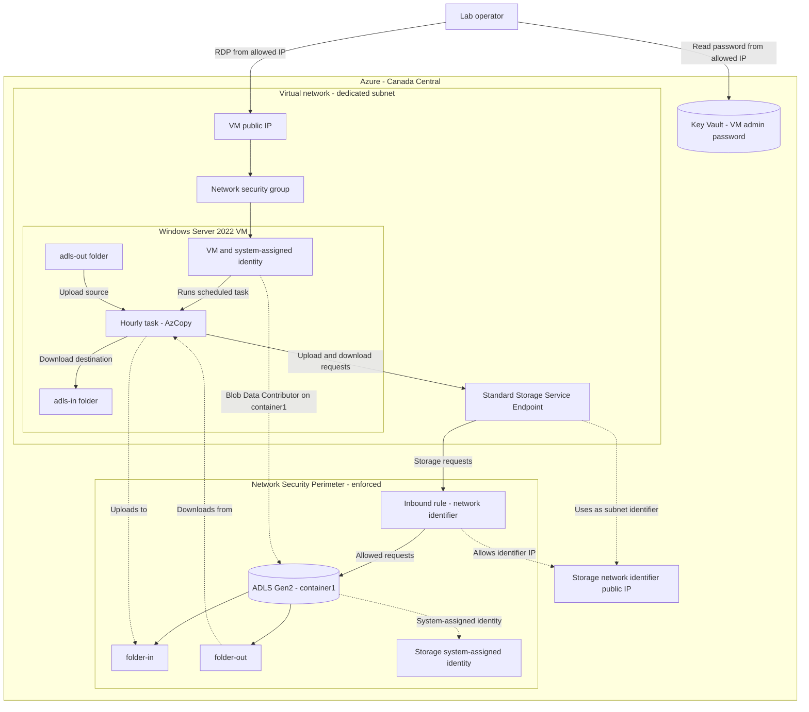

# Windows Server and ADLS Gen2 lab

This Terraform lab creates a Windows Server 2022 VM, Key Vault, and a hierarchical-namespace storage account in Canada Central. Terraform generates the Windows administrator password and stores it in Key Vault. A system-assigned VM identity receives **Storage Blob Data Contributor** on `container1`, including read, write, and delete permissions; AzCopy does not require a stored credential. The storage account has its own separate system-assigned identity for NSP membership, with no additional roles assigned by this lab. The storage account disables shared-key and anonymous access.

The VM extension installs AzCopy, registers the `AdlsLabCopy` scheduled task as Local System, and initializes `container1/folder-in` and `container1/folder-out` using the VM identity. Every hour the task ensures those directories exist, uploads the contents of `C:\adls-out` to `folder-in`, then downloads `folder-out` to `C:\adls-in`. Both directions include subfolders and overwrite an existing destination only when the source is newer. Nothing is deleted or moved by the job. Avoid changing files during a transfer.

## Architecture

<!-- mermaid-checked: no \n, no em-dash/en-dash, no {} in labels, subgraphs are id["label"], arrows are -->|"label"|, all subgraphs closed by end, ids unique -->


The network identifier is separate from the VM public IP and identifies the subnet's storage traffic; it is not an outbound routing address.

## Networking

The VM's public IP is for restricted RDP and internet access; it is **not** the address used to identify storage traffic. The dedicated VM subnet has a Standard Service Endpoint with a separate public-IP network identifier. An enforced Network Security Perimeter (NSP) permits that identifier's `/32` and the storage account is created in `SecuredByPerimeter` mode. This authorizes the subnet, not the VM identity alone: do not place other workloads in this subnet. RBAC still controls data operations. This is not a private endpoint; private endpoint traffic would bypass NSP rules.

Key Vault uses RBAC and permits data-plane access only from the operator's public IPv4 CIDR, which defaults to the RDP source CIDR. If Terraform runs from a different public IP, set `key_vault_source_cidr` separately. The Terraform operator receives **Key Vault Secrets Officer** on this vault. The VM does not receive access to the vault.

Standard Service Endpoint is a **preview**, requires subscription feature registration, and may not be suitable for production. See [Microsoft's Terraform quickstart](https://learn.microsoft.com/en-us/azure/private-link/configure-service-endpoint-standard-terraform). The VM, public IPs, disk, storage, Key Vault, and network resources incur charges; confirm current prices and deallocate/destroy the lab when finished.

## Prerequisites

- Terraform 1.5 or later, Azure CLI, and an authenticated Azure subscription.
- Permissions to create resources and role assignments, plus `Microsoft.Network/publicIPAddresses/joinServiceEndpointNetworkIdentifier/action` for the network identifier. Check organizational policies and regional VM quota/capacity.
- Register the preview feature **before** applying. Registration can take time and may require subscription-level permissions:

  ```powershell
  az login
  az account set --subscription '<subscription-id>'
  az feature register --namespace Microsoft.Network --name AllowServiceEndpointNetworkIdentifier
  az feature show --namespace Microsoft.Network --name AllowServiceEndpointNetworkIdentifier --query properties.state -o tsv
  # When the preceding command returns Registered:
  az provider register --namespace Microsoft.Network
  ```

- An operator public IPv4 CIDR for RDP and the Key Vault firewall. The template accepts `/24` through `/32`; prefer a single public IP as `/32`. Adjust the appropriate CIDR when your operator IP changes. If a separate CI runner deploys the lab, its public egress IP must be permitted for Key Vault data-plane operations.
- The VM must reach Microsoft Entra ID, Azure Storage, and the AzCopy download URL over HTTPS. The extension downloads the current AzCopy v10 release at deployment time; it is not pinned.

## Deploy

From this directory in PowerShell, set the subscription and RDP source. If the machine running Terraform reaches Key Vault from a different public IP, also set `TF_VAR_key_vault_source_cidr`.

```powershell
$env:TF_VAR_subscription_id = '<subscription-id>'
$env:TF_VAR_rdp_source_cidr = '<your-public-ip>/32'
# Optional: $env:TF_VAR_key_vault_source_cidr = '<terraform-egress-ip>/32'
terraform init
terraform validate
terraform plan -out=tfplan
terraform apply tfplan
terraform output
```

**Key Vault does not keep the password out of Terraform state:** the generated password, secret value, and VM password are persisted in state. Plan files may also contain sensitive values. The default local state is not encrypted by Terraform. Protect access to these files and, for shared use, configure an encrypted remote backend with appropriate access controls. The repository's `.gitignore` excludes state, plans, and variable files; never force-add them or commit copies or logs containing secrets.

The Terraform operator needs permissions to create resources and role assignments. Key Vault secret operations require network access from the allowed public IP and the newly assigned Secrets Officer role. Role assignment propagation can delay the first apply; if it fails with an authorization error, wait and rerun `terraform apply`. Storage container creation uses the Azure management plane, not a connection from the operator to the restricted storage data endpoint.

Retrieve the generated `windows-admin-password` secret from the Key Vault named by `terraform output -raw key_vault_name`, using the Azure portal from an allowed network and an identity with secret-read permissions. Avoid exposing the value in terminal logs, transcripts, or chat. Changing or rotating the Key Vault secret separately does not change the VM password; plan and coordinate any rotation.

The extension initializes both directories through the VM's storage connection and retries a storage `AuthorizationPermissionMismatch` briefly while RBAC propagates. If initialization still fails, the extension reports failure; inspect `C:\ProgramData\AdlsLab\transfer.log`, resolve RBAC or network configuration, and rerun the extension. The registered task also retries directory initialization on every run. The first run starts approximately five minutes after configuration; subsequent runs repeat hourly. Directory initialization does not prove that file transfers work.

## Test on the VM

Connect using the `vm_public_ip` output and the configured credentials. In an elevated PowerShell session:

```powershell
Set-Content -Path C:\adls-out\upload-test.txt -Value 'ADLS upload test'
Start-ScheduledTask -TaskName AdlsLabCopy
Get-ScheduledTaskInfo -TaskName AdlsLabCopy
Get-Content C:\ProgramData\AdlsLab\transfer.log -Tail 100
```

Wait for the task to finish, then check its result and verify `folder-in/upload-test.txt` in the container. To test downloads, put a different test file in `folder-out` from an authorized client, start the task again, and verify it appears in `C:\adls-in`. Accessing the storage data plane requires both a permitted network and data permissions. Check `C:\ProgramData\AdlsLab\azcopy-logs` and Task Scheduler history if the task fails. The task runs as SYSTEM, so use the task rather than your interactive user to test the same managed-identity workflow. To test delete permissions separately, run as SYSTEM or use a suitable SYSTEM shell, set `AZCOPY_AUTO_LOGIN_TYPE=MSI`, and use AzCopy's `remove` command on a disposable blob. Delete is **not** part of the scheduled job.

The job accepts already-existing directories, but reports other storage conflicts. Failed HTTP requests include the Azure error code and request ID in `C:\ProgramData\AdlsLab\transfer.log`. After updating this template on an existing lab, review and apply a fresh Terraform plan so the VM extension installs the updated script, then start the task again. The old `container1/files` directory and its contents are not moved or deleted.

To run the local, mocked transfer-script checks without Azure access, run `powershell.exe -NoProfile -File .\tests\transfer.Tests.ps1` from this directory.

To confirm the NSP boundary, test access from a client outside the authorized subnet using an identity that has data permissions: it should be rejected. Check Azure Storage/NSP diagnostic logs to investigate a denial. No diagnostic workspace is included in this minimal lab.

## Clean up

After reviewing what will be removed, run `terraform plan -destroy` and then `terraform destroy`. Destroying the storage account permanently removes its data. Key Vault and secret soft-delete and purge behavior also apply; protect any credentials you still need. Stop or deallocate the VM when not in use to reduce compute charges; disks and other resources can still incur charges.

References: [AzCopy managed identity](https://learn.microsoft.com/en-us/azure/storage/common/storage-use-azcopy-authorize-managed-identity), [AzCopy copy](https://learn.microsoft.com/en-us/azure/storage/common/storage-use-azcopy-blobs-upload), and [NSP modes](https://learn.microsoft.com/en-us/azure/private-link/network-security-perimeter-transition).
