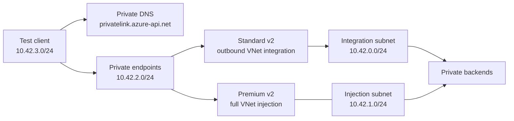

# API Management v2 private networking comparison

This lab deploys one Azure API Management Standard v2 instance and one Premium v2 instance with one capacity unit each. It provides a controlled comparison of the private networking features supported by each tier.

> Cost warning: API Management Premium v2 is a high-cost resource and can take a long time to provision or delete. Run What-If first, confirm current pricing, and remove the resource group as soon as testing is complete.

## Why Canada Central

The original target was Central US. At the time this lab was prepared, creation of new Premium v2 instances was temporarily unavailable in Central US. Both instances therefore use `canadacentral` so the comparison stays in one region. Recheck regional availability before changing the parameter file.

## Architecture



The topology intentionally differs by tier:

| Capability | Standard v2 | Premium v2 |
|---|---|---|
| Units | 1 | 1 |
| Outbound access to private backends | VNet integration | VNet injection |
| Gateway inbound private access | Private endpoint | Injected private gateway plus private endpoint for comparison |
| Dedicated delegated subnet | `Microsoft.Web/serverFarms` | `Microsoft.Web/hostingEnvironments` |
| VNet mode in template | `External` | `Internal` |
| Public network access at creation | Enabled | Enabled |

Standard v2 does not support full VNet injection. Premium v2 injection is selected at creation and cannot be switched to VNet integration later. The Premium private endpoint is intentionally redundant with the injected private gateway, allowing both inbound mechanisms to be inspected.

## Address plan

| Resource | CIDR | Purpose |
|---|---|---|
| VNet | `10.42.0.0/16` | Lab network |
| Standard v2 subnet | `10.42.0.0/24` | Outbound VNet integration |
| Premium v2 subnet | `10.42.1.0/24` | Full VNet injection |
| Private endpoint subnet | `10.42.2.0/24` | Both gateway private endpoints |
| Test client subnet | `10.42.3.0/24` | Optional VM or connected test host |

The template does not deploy a test VM, NAT Gateway, VPN, or ExpressRoute connection. Use an existing connected client or add a temporary VM to the test subnet when private DNS and data-plane tests are required.

## Files

- [deployment-plan.md](./deployment-plan.md): architecture decisions, validation evidence, and deployment record.
- `main.bicep`: subscription-scoped entry point and resource-group creation.
- `main.bicepparam`: Canada Central lab values.
- `modules/lab.bicep`: networking, private DNS, private endpoints, and APIM instances.
- `Deploy-ApimV2Lab.ps1`: provider checks, validation, What-If, and guarded deployment.
- `Test-ApimPrivateConnectivity.ps1`: private DNS, TCP/443, and APIM health endpoint checks.
- `Remove-ApimV2Lab.ps1`: guarded resource-group cleanup.

## Prerequisites

1. Azure CLI with Bicep support.
2. PowerShell 5.1 or later.
3. An Azure subscription where you can create a resource group, networking resources, private endpoints, private DNS zones, and both APIM v2 SKUs.
4. Available APIM capacity in Canada Central.
5. Permission to register `Microsoft.ApiManagement`, `Microsoft.Network`, and `Microsoft.Web` if needed.

Sign in and identify the target subscription:

```powershell
az login
az account list --query "[].{Name:name, SubscriptionId:id, IsDefault:isDefault}" --output table
$subscriptionId = '<subscription-id>'
```

## Local build

```powershell
Set-Location C:\Users\xaelizon\Downloads\GH\Shell-Power\Az-Network\API-GW
az bicep restore --file main.bicep --force
az bicep build --file main.bicep
```

## Validate and review

Validation does not create resources:

```powershell
.\Deploy-ApimV2Lab.ps1 -SubscriptionId $subscriptionId -Mode Validate
```

Review the Azure Resource Manager What-If result:

```powershell
.\Deploy-ApimV2Lab.ps1 -SubscriptionId $subscriptionId -Mode WhatIf
```

Confirm that the result is limited to the intended resource group, VNet, four subnets, two NSGs, private DNS zone/link, two APIM instances, and two gateway private endpoints. Also check current APIM pricing before continuing.

## Deploy

The deployment script requires an extra switch for the billable operation:

```powershell
.\Deploy-ApimV2Lab.ps1 `
    -SubscriptionId $subscriptionId `
    -Mode Deploy `
    -ConfirmDeployment
```

APIM provisioning can take a substantial amount of time. Inspect status with:

```powershell
az apim list `
    --resource-group rg-apim-v2-network-lab `
    --query "[].{Name:name,Sku:sku.name,State:provisioningState,VNet:virtualNetworkType,PublicAccess:publicNetworkAccess}" `
    --output table

az network private-endpoint list `
    --resource-group rg-apim-v2-network-lab `
    --query "[].{Name:name,State:privateLinkServiceConnections[0].privateLinkServiceConnectionState.status,Subnet:subnet.id}" `
    --output table
```

## Test private connectivity

Run the test from a Windows VM in `snet-test-clients` or from a machine connected to the VNet through peering, VPN, or ExpressRoute:

```powershell
.\Test-ApimPrivateConnectivity.ps1
```

For both `<name>.azure-api.net` gateway names, expect:

- DNS resolves to an RFC 1918 private address.
- TCP port 443 succeeds.
- The APIM status endpoint returns an HTTP response.

Run the same DNS lookup from an unconnected public machine. Standard v2 with outbound VNet integration can still resolve and use its public gateway while public network access is enabled. Premium v2 in `Internal` injection mode is expected to require a private DNS/network path for its gateway, even when the resource reports public network access as enabled. Neither instance should return the private endpoint address to an unconnected client unless that client uses a DNS path linked or forwarded to the lab private zone.

## Comparison exercises

1. Deploy a private backend in the VNet and import it into both APIM instances.
2. Confirm Standard v2 reaches it through the integration subnet.
3. Confirm Premium v2 reaches it from the injected subnet.
4. Compare gateway DNS and private endpoint network interfaces.
5. Record control-plane access separately from gateway data-plane access; the private endpoint supports the `Gateway` subresource, not every APIM endpoint.
6. Only after private connectivity is proven, test disabling public network access one instance at a time. Keep a recovery path and rerun both connected and unconnected client tests.

To disable public network access after validation:

```powershell
az apim update --resource-group rg-apim-v2-network-lab --name <apim-name> --public-network-access false
```

Re-enable it with the same command and `--public-network-access true` if the test does not behave as expected.

## Cleanup

The cleanup command deletes the entire lab resource group. Review the target and approve the PowerShell confirmation prompt:

```powershell
.\Remove-ApimV2Lab.ps1 -SubscriptionId $subscriptionId
```

Deletion starts asynchronously. Track it with:

```powershell
az group wait --name rg-apim-v2-network-lab --deleted
```

## Operational notes

- Each APIM instance uses a globally unique name generated from the subscription and resource group IDs.
- Public network access starts enabled to reduce deployment lockout risk. That is not the final hardening posture.
- The private DNS zone is linked only to this lab VNet. Peered or on-premises clients need the appropriate DNS links or Azure DNS Private Resolver/conditional forwarding path.
- Do not reuse either delegated APIM subnet for private endpoints or unrelated resources.
- `availabilityZones` is empty for this one-unit comparison. Zone redundancy requires a different capacity and cost design.
- Private endpoint approval is automatic for endpoints created in the same deployment and subscription context, subject to Azure authorization.

## References

- [API Management v2 tiers](https://learn.microsoft.com/azure/api-management/v2-service-tiers-overview)
- [Integrate Standard v2 with a virtual network](https://learn.microsoft.com/azure/api-management/integrate-vnet-outbound)
- [Inject Premium v2 into a virtual network](https://learn.microsoft.com/azure/api-management/inject-vnet-v2)
- [Private endpoint for API Management](https://learn.microsoft.com/azure/api-management/private-endpoint)
- [API Management private DNS guidance](https://learn.microsoft.com/azure/private-link/private-endpoint-dns#azure-services-dns-zone-configuration)
- [Azure Resource Manager What-If](https://learn.microsoft.com/azure/azure-resource-manager/bicep/deploy-what-if)
- [Azure API Management pricing](https://azure.microsoft.com/pricing/details/api-management/)